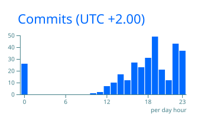
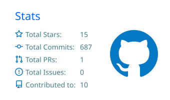
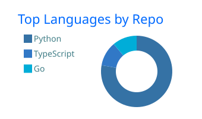
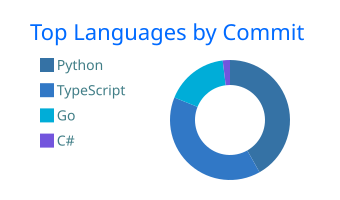

  

  
  

I build backend services, automation pipelines, and tools around the Telegram ecosystem. Most of my work is in Python: asyncio, FastAPI, MTProto (Telethon and Hydrogram), and agent workflows. Right now, I am spending time with Go and Python.

### Tech stack

**Core & Backend**

  
  
  
  
  

**Telegram Ecosystem**

  
  
  

**Infra & Environment**

  
  
  
  
  
  

### GitHub activity & stats

<table width="100%" border="0" cellspacing="0" cellpadding="0">
  <tr>
    <td width="50%" align="center" valign="middle">
      
    </td>
    <td width="50%" align="center" valign="middle">
      
    </td>
  </tr>
  <tr>
    <td width="50%" align="center" valign="middle">
      
    </td>
    <td width="50%" align="center" valign="middle">
      
    </td>
  </tr>
</table>

### Contribution graph

<picture>
  <source media="(prefers-color-scheme: dark)" srcset="assets/github-snake-dark.svg" />
  <source media="(prefers-color-scheme: light)" srcset="assets/github-snake.svg" />
  
</picture>

  

